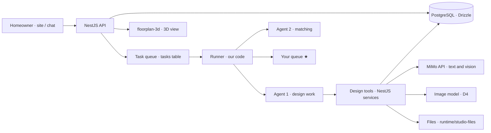

# The design agent: final system solution

I Renovation · JUNCTION CHINA 2026 · last updated 2026-11-07

This is the build spec for the **design work of Agent 1** (D22): from an uploaded floor plan to a design package a homeowner can confirm and contractors can price. It sits inside the NestJS app in `studio/` (D20) and its PostgreSQL database (Drizzle ORM, PGlite on this PC). The business rules stay in [WORKFLOW.md](WORKFLOW.md) (stage 2, sections 5, 6 and 8); the item IDs (F2, N4, N5…) are defined in [CHANGES.md](CHANGES.md) section 4.

Contents:

1. What the design agent delivers
2. Where it sits in the system
3. The pipeline, step by step
4. Data model (new tables)
5. API routes
6. Tools the agent gets
7. Checks (N6) and the boss's sign-offs
8. When things go wrong
9. Agent frameworks: DeerFlow, Deep Agents, and the choice
10. Build order, with what "done" means
11. Open points

---

## 1. What the design agent delivers

For one project, from the homeowner's requirement sheet and floor plan image:

| # | Deliverable | Format | Made by |
|---|---|---|---|
| 1 | **Plan JSON**: walls (with type: load-bearing / non-bearing / unknown), doors, windows, rooms with names and areas, in mm (F2) | JSON, validated | MiMo vision + code checks (N4) |
| 2 | **Overlay image**: the plan JSON drawn over the uploaded image, so a person can check it by eye | PNG | code |
| 3 | **Renovation report** (户型与改造报告): what works, what can and can't change, what to settle before design | page (N16), both languages | MiMo, from a template |
| 4 | **2–3 design options**, each a layout of the whole home in one full-home style (全屋风格), applied to every room | design JSON (floorplan-3d's format) | MiMo + code checks |
| 5 | **3D link** for each option | floorplan-3d opened by its private link (F1) | code |
| 6 | **Renders**: key rooms of each option, labelled "AI 生成 · AI-generated" | images (N21) | image model (D4) |
| 7 | **Material list, scope of work and budget** (报价单) | table, each line with its source | code, from quantities × price table (N5) |
| 8 | **Versions**: every change saved as a new numbered version; one is confirmed | design versions (F6) | homeowner or agent |

Principle: **the model proposes, the code decides.** Every number (area, quantity, price) is computed by code from JSON, never typed by the model; the model chooses the layout, the style and the words.

## 2. Where it sits in the system

- **Built today:** accounts, projects, matching, uploads (photo metadata removed), consent, the task queue, the runner with retry/escalate, and Agent 1/Agent 2 with their first tools (`studio/src/api/agents/`, `tasks/`).
- **This spec adds:** a `design` module (`studio/src/api/design/`) with its tables, routes and the agent tools below. The runner, task records and sign-offs are reused as they are; nothing is built twice.

## 3. The pipeline, step by step

Each step is one task in the `tasks` table (so each is a run record with its cost), handed from step to step by the runner. ★ waits for you.

| Step | Task (`task`) | Input | What happens | Output | Checks | ★ |
|---|---|---|---|---|---|---|
| D1 | `plan-read` | floor plan upload, 2–3 measured walls | MiMo vision reads rooms, labels, walls, openings → plan JSON. Scale from the measured walls | plan JSON v1 + overlay | F2 schema; closed rooms; scale consistent within 3%; areas within 5% of labelled ones | only on failure |
| D2 | `report` | plan JSON, requirement sheet | fills the renovation report template | report page | language; every claim about a wall cites its type; unknown walls treated as load-bearing | approve before sending (first 10 orders) |
| D3 | `style-brief` | requirements (style, budget, household) | picks 2–3 styles from `DESIGN_STYLES` with the reason for each; asks the homeowner if unclear | style brief | styles are from the list; within budget band | — |
| D4 | `layout` (×2–3) | plan JSON, style brief | writes design JSON per option: furniture (floorplan-3d `LIB` types, centre/size/rotation in mm), room flooring, walls to remove (non-bearing only) | design JSON options | geometry (section 7) | — |
| D5 | `quantities` | design JSON | **code** computes floor/wall/ceiling areas, tiles, paint, skirting, doors, wet-room waterproofing… per room | quantity list | sums match room areas | — |
| D6 | `pricing` | quantities, price table (N5) | **code**: quantity × unit price per line, with source and date → material list, scope of work, budget | budget per option | total vs homeowner's budget; every line has a source | — |
| D7 | `render` | design JSON + 3D view snapshot | image model restyles key rooms | renders, labelled | label present; one per key room | — |
| D8 | `package` | all of the above | assembles the design package page (N16, N7) | package | completeness, language, AI labels | **approve before delivery (D6)** |
| D9 | `revision` | homeowner's edits (F6) or chat request | new version: edits saved as-is, or the agent writes a new design JSON; D5–D8 rerun for it | version n+1 | same as D4–D8 | approve |
| D10 | `confirm` | homeowner's pick of a version | freezes it; scope of work and quantities go to the project for the quote sheet (N22) | confirmed version | version unchanged since checks | — |

Paid order rule (WORKFLOW 4.2): work starts at once; D8 releases only a preview until you confirm the payment.

## 4. Data model (new tables)

Added to `studio/src/api/db/schema.ts`, one migration (`0005_design`). Existing tables reused: `projects`, `uploads`, `tasks`, `users`.

| Table | Key columns | Notes |
|---|---|---|
| `plans` | `id`, `project_id` → projects, `upload_id` → uploads, `version`, `plan` jsonb (F2), `scale_mm_per_px`, `status` (`draft` / `checked` / `needs-person`), `check_report` jsonb, `created_by` (`agent-1` / `homeowner` / `contractor`) | Site measurements in stage 4 add a new version, never overwrite |
| `designs` | `id`, `project_id`, `plan_id` → plans, `option` (A/B/C), `version`, `style` (`DESIGN_STYLES`), `design` jsonb (floorplan-3d format), `parent_id` (the version it came from), `source` (`agent` / `homeowner-edit`), `status` (`draft` / `checked` / `delivered` / `confirmed` / `superseded`), `check_report` jsonb | Unique (project, option, version); at most one `confirmed` per project (partial unique index, like `invitations_one_selected`) |
| `quantities` | `id`, `design_id`, `room`, `item`, `unit`, `qty` numeric, `formula` text | Computed by code; `formula` says how (e.g. "floor 12.4 m² × 1.05 waste") |
| `price_items` | `id`, `city`, `code`, `name_zh`, `name_en`, `unit`, `price_cny` numeric, `kind` (labour / main material / auxiliary / fee), `source`, `collected_on` date, `approved_by` | The price table (N5); you approve each row (D6). Old prices kept, newest used |
| `budget_lines` | `id`, `design_id`, `quantity_id`, `price_item_id`, `amount_cny` | Joins quantities × prices; totals are sums, never stored by hand |
| `renders` | `id`, `design_id`, `room`, `upload_id` (the image file), `model`, `labelled` bool | Images live with uploads, under `runtime/studio-files` |
| `deliverables` | `id`, `project_id`, `kind` (`report` / `design-package` / …), `language`, `ref` (design or plan id), `status` (`draft` / `approved` / `sent`), `preview_only` bool, `approved_at` | Closes N7's gap: what `tasks.result` holds today moves here |

Rules kept by the database, not only the code: check constraints on positive quantities and prices; foreign keys with `on delete cascade` from the project; JSON columns validated by the service before insert (F2 and design schemas as TypeScript types + runtime validators).

## 5. API routes

All under `/api`, homeowner routes owner-only (like `GET /projects/:id`), admin routes with the admin key.

| Route | Who | What |
|---|---|---|
| `POST /projects/:id/plans` `{uploadId, measuredWalls[]}` | homeowner | starts D1 (creates the task) |
| `GET /projects/:id/plans` / `GET /plans/:id` | homeowner | plan versions with check report and overlay link |
| `POST /projects/:id/design` `{options: 2–3}` | homeowner | starts D2–D8 (after the order, D3) |
| `GET /projects/:id/designs` | homeowner | options and versions, with status and budget totals |
| `GET /designs/:id` | homeowner; invited team after a pick | design JSON, quantities, budget lines, renders; this is what floorplan-3d loads (F1) |
| `POST /designs/:id/versions` `{design}` | homeowner | saves an edit from floorplan-3d (F6); triggers D5–D8 for it |
| `POST /designs/:id/revision` `{request}` | homeowner | one free revision by the agent (D9) |
| `POST /designs/:id/confirm` | homeowner | D10 |
| `GET/POST /admin/price-items` | you | the price table (N5) |
| `GET /admin/deliverables?status=draft` | you | what waits for your approval; decisions go through the existing `/admin/tasks/:id/decision` |

## 6. Tools the agent gets

Added to `AGENT_TOOLS['agent-1']` in `studio/src/api/agents/definitions.ts`, each a method of the design services (`tools.ts` pattern: the runner enforces the agent's own list).

| Tool | Does | Returns to the model |
|---|---|---|
| `read_plan_image` | sends the upload to MiMo vision with the F2 instructions | draft plan JSON |
| `save_plan` | validates against F2, computes areas, draws the overlay, stores a version | check report (errors the model can fix) |
| `list_furniture` | floorplan-3d's `LIB` types with default sizes | the catalogue |
| `save_design` | validates geometry (section 7), stores an option/version | check report |
| `compute_budget` | D5 + D6 in code for one design | totals per room and trade, budget vs homeowner's range |
| `render_room` | image model call (N21), stamps the AI label | render id |
| `fill_template` | report / package page in the reader's language (N16) | page id |
| existing: `read_project`, `save_result`, `hand_off`, `ask_boss`, `draft_message` | | |

No tool takes money, deletes a version, or sends anything to a homeowner directly: delivery goes through your approval (D6).

## 7. Checks (N6) and the boss's sign-offs

Code, run by the runner after every `save_plan` / `save_design` and before D8:

- **Structure:** no removed or cut wall is load-bearing or unknown (unknown counts as load-bearing until the homeowner shows drawings).
- **Wet rooms:** no bathroom or kitchen over a room that wasn't wet before (住宅室内装饰装修管理办法: read the current text before relying on it).
- **Geometry:** furniture inside its room, not overlapping, not blocking a door swing; walkways ≥ 800 mm (proposal); every room keeps a door.
- **Numbers:** room areas sum to the plan's area within 2%; every budget line has a source; option budget vs homeowner's range flagged (not refused).
- **Language and labels:** text in the reader's language; every AI image labelled.
- **Injection:** text from uploads that tries to instruct the agent is flagged (WORKFLOW 4.6).

A failed check returns to the agent with the reasons (one retry); a second failure escalates to you (the runner already does this).

## 8. When things go wrong

| Problem | What happens |
|---|---|
| Plan image unreadable, or checks fail twice | task escalated; you ask the homeowner for a better photo or hand measurements |
| MiMo down / out of credits | tasks wait (built); homeowner told the design is delayed, from a prepared message |
| Image model down (D4 open) | package goes out with 3D links only, marked "renders follow" |
| Budget far over the homeowner's range | the agent proposes cheaper materials in a new version, and says so; never hides it |
| Homeowner's own edit breaks a rule | saved as their version, with the failed check shown; it can't be confirmed until fixed |

## 9. Agent frameworks: DeerFlow, Deep Agents, and the choice

Rule 7 (free and open source) applies; re-check each licence file before adding anything, and log it in CHANGES.md.

| Framework | What it is | Language | Licence (to confirm) | Fit for us |
|---|---|---|---|---|
| **Our runner** (`studio/src/api/agents/`) | task queue, tools per agent, retry/escalate, run records in Postgres | TypeScript, in NestJS | ours | Built and tested. Already gives the judges handoffs and run records |
| **LangGraph.js** | graph of steps with state, checkpoints and human-in-the-loop interrupts | TypeScript | MIT | Runs inside NestJS; a good fit for the D1–D10 pipeline with ★ interrupts |
| **Deep Agents** (LangChain `deepagents`, JS version `deepagentsjs`) | an agent with a planning tool (todo list), a virtual file system and sub-agents, on LangGraph | Python and TypeScript | MIT | The JS version runs in-process; useful *inside* Agent 1 for long design tasks (plan → sub-agent per room → merge) |
| **DeerFlow** (ByteDance) | multi-agent deep-research flow (planner, researcher, coder, reporter), web search, human feedback | Python (LangGraph) | MIT | Research, not design. Fits Agent 2's price-table and competitor research, as a separate Python service called over HTTP. Its default search providers may be closed services (D9): use a free one |
| CrewAI / AutoGen | role-based multi-agent | Python | MIT / MIT (check) | Would duplicate our runner; not recommended |

**Decided 2026-11-07 (D24): Deep Agents JS, inside the runner. Built: `studio/src/api/agents/deep.ts`; design-stage tasks of Agent 1 run on it, with one `room-designer` sub-agent, and its model calls, sub-agents included, are counted in the task's cost. DeerFlow stays optional and not built.**

**The recommendation this came from:**

1. **Keep the NestJS runner as the orchestrator** of the two agents (D22): it owns the queue, the ★ sign-offs and the run records. Two orchestrators would run in parallel, which the project rules forbid.
2. **Inside Agent 1's design work, use Deep Agents JS (on LangGraph.js)** for the planning and per-room sub-agents, wrapped as one runner task type. Its tools are the NestJS tools of section 6; its checkpoints go to our Postgres.
3. **DeerFlow, optional, for Agent 2's research only**, as a sidecar (`runtime/deerflow/`, Python), with its output saved to `price_items` as drafts you approve. It never talks to homeowners.
4. MiMo is reached through an OpenAI-compatible endpoint in all three (to confirm against the event's model access docs).

If time is short: skip both frameworks; the runner plus the tools in section 6 deliver the same pipeline, and only the in-task planning is simpler.

## 10. Build order, with what "done" means

| # | Build | Done when |
|---|---|---|
| 1 | F2 plan JSON format + validator; `plans` table; `save_plan` | a hand-written plan of the sample flat passes; a broken one fails with readable reasons (tests) |
| 2 | N4: `read_plan_image` + overlay | the sample flat's image becomes plan JSON within the area tolerance; overlay drawn |
| 3 | `designs` table, design schema, geometry checks, `save_design` | floorplan-3d's sample design passes; furniture through a wall fails (tests) |
| 4 | N5: `price_items`, quantities and budget in code | budget for the sample design, every line sourced; totals equal the sum of lines (tests) |
| 5 | D1–D8 as runner tasks with the scripted MiMo, then the real one | a project goes from upload to package waiting for your approval, in both languages |
| 6 | Routes of section 5; F1/F6 in floorplan-3d | the homeowner opens option A in 3D, edits it, gets version 2 with a new budget |
| 7 | N21 renders + labels (needs D4) | renders labelled; package complete |
| 8 | Deep Agents JS inside Agent 1 (chosen, D24) | **Engine built** and tested with a scripted model (6 tests). Still to do: the room sub-agent's real prompts and the design tools of section 6, once they exist; checkpoints into Postgres |
| 9 | DeerFlow sidecar for Agent 2 (if chosen) | a price-research run drafts `price_items` rows for your approval |

## 11. Open points

- D4 (image model) is still open, so renders can't be built until you pick one.
- Price table: who collects the first city's prices, and from which public sources.
- Framework choice (section 9): yours. It goes in the decision log when made.
- The legal rules on wet rooms and load-bearing walls must be read in their current text before the checks are relied on.
